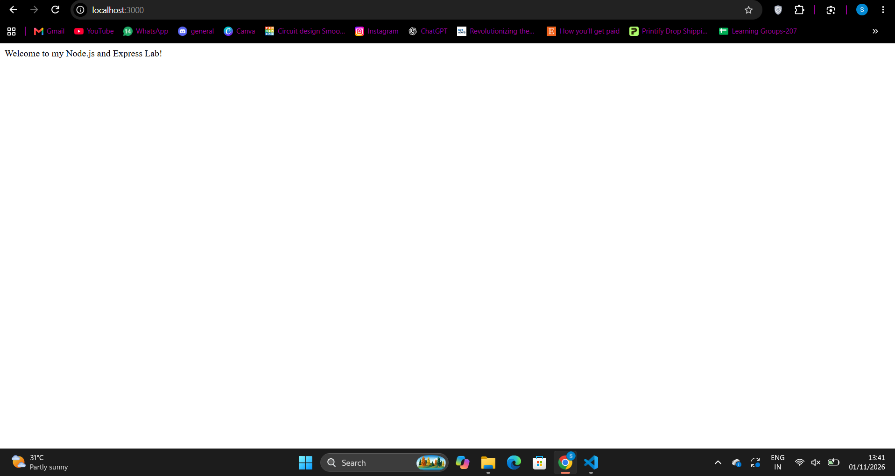
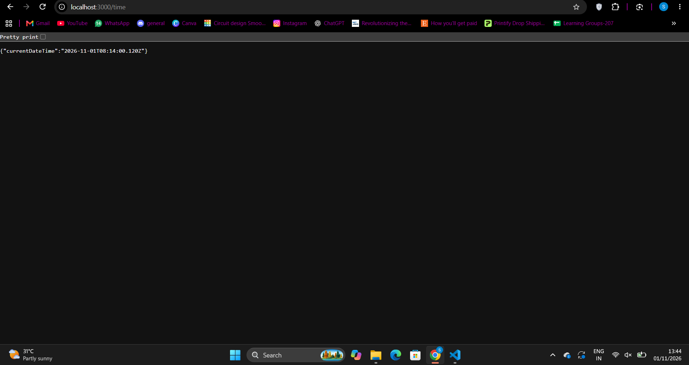
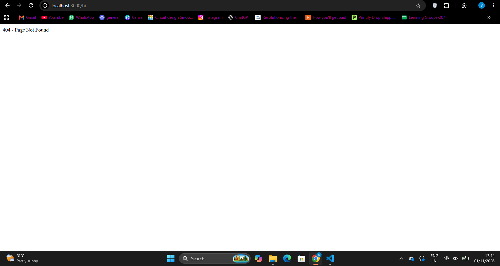

# 🚀 BDF Lab 01 – Node.js & Express Server

This project demonstrates the fundamentals of backend development using Node.js and Express.js. It includes a basic HTTP server, Express server, API routes, JSON responses, and 404 error handling.

## 🌐 Live Deployment

**Live URL:** https://bdf-lab-01-9ky8.onrender.com

### API Endpoints

- 🏠 [Home](https://bdf-lab-01-9ky8.onrender.com/)
- 👤 [About](https://bdf-lab-01-9ky8.onrender.com/about)
- 🕒 [Current Time](https://bdf-lab-01-9ky8.onrender.com/time)
- ❌ [404 Test](https://bdf-lab-01-9ky8.onrender.com/anything)

## 👩‍💻 Author Information

- **Name:** Kadiyala Sama Kruthika
- **Registration Number:** Add your registration number
- **Section:** S-002
- **Subject:** Backend Development Fundamentals

## 📁 Project Structure

```text
BDF-Labs/
└── lab-01/
    ├── screenshots/
    │   ├── home.png
    │   ├── about.png
    │   ├── time.png
    │   └── not-found.png
    ├── .gitignore
    ├── package.json
    ├── package-lock.json
    ├── server-http.js
    ├── server.js
    └── README.md
```

## ⚙️ Getting Started

### Prerequisites

- Node.js
- npm
- Visual Studio Code

### Installation

1. Clone the repository:

```bash
git clone https://github.com/Samaaa-ai/BDF-Labs.git
```

2. Navigate to the Lab 1 folder:

```bash
cd BDF-Labs/lab-01
```

3. Install dependencies:

```bash
npm install
```

## ▶️ Running the Project

### 1. Basic Node.js HTTP Server

```bash
node server-http.js
```

The server runs at:

`http://localhost:3000`

### 2. Express.js Server

```bash
npm start
```

The Express server runs at:

`http://localhost:3000`

For development with automatic restart:

```bash
npm run dev
```

## 🔗 API Endpoints

| Method | Endpoint | Description | Expected Status |
|---|---|---|---|
| GET | `/` | Displays welcome message | 200 |
| GET | `/about` | Returns name and section as JSON | 200 |
| GET | `/time` | Returns current date and time | 200 |
| GET | `/anything` | Handles unknown routes | 404 |

### Sample Responses

**GET /**

```text
Welcome to my Node.js and Express Lab!
```

**GET /about**

```json
{
  "name": "K. Sama Kruthika",
  "section": "S-002 AIML-2B"
}
```

**GET /time**

```json
{
  "currentDateTime": "Current date and time"
}
```

**GET /anything**

```json
{
  "message": "404 - Page Not Found"
}
```

## 📸 Screenshots

### Home Page


### About Route


### Time Route


### 404 Error Handling


## 🛠️ Built With

- **Node.js** – JavaScript runtime environment
- **Express.js** – Backend web framework
- **JavaScript** – Server-side programming language
- **Git & GitHub** – Version control and repository hosting
- **Render** – Cloud deployment platform

## 🎯 Learning Outcomes

- Understanding Node.js and backend development.
- Creating an HTTP server using Node.js.
- Building an Express application.
- Creating GET routes and handling requests and responses.
- Sending JSON responses.
- Implementing 404 error handling.
- Deploying a backend application using Render.