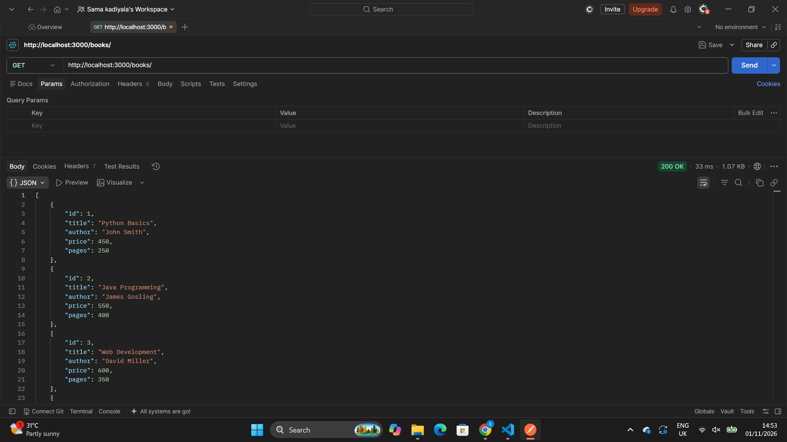
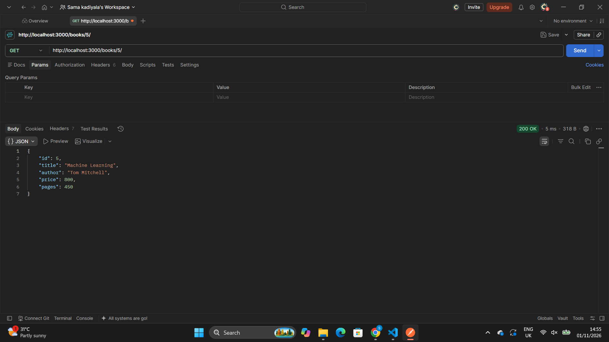
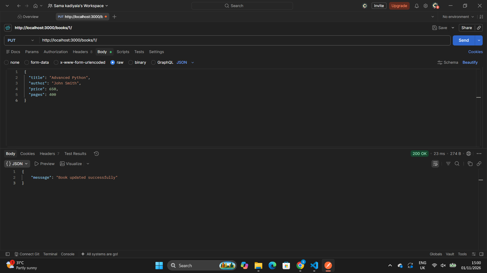
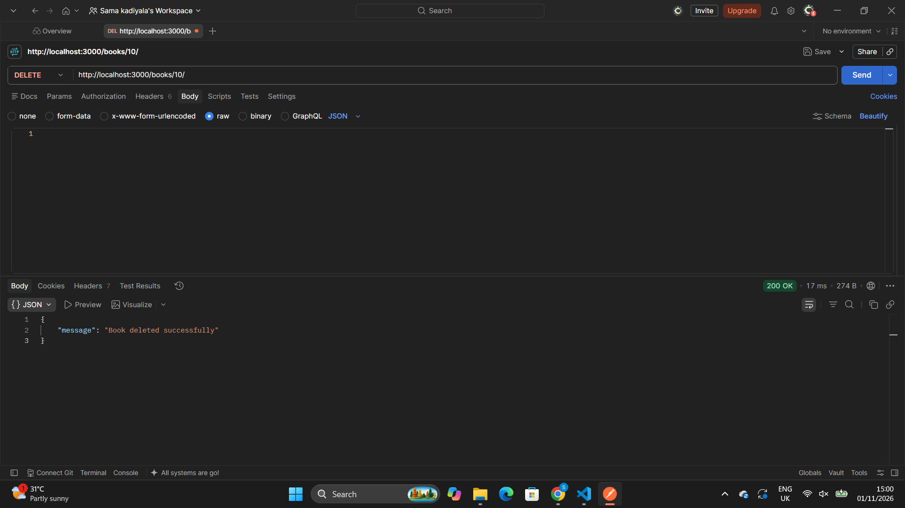
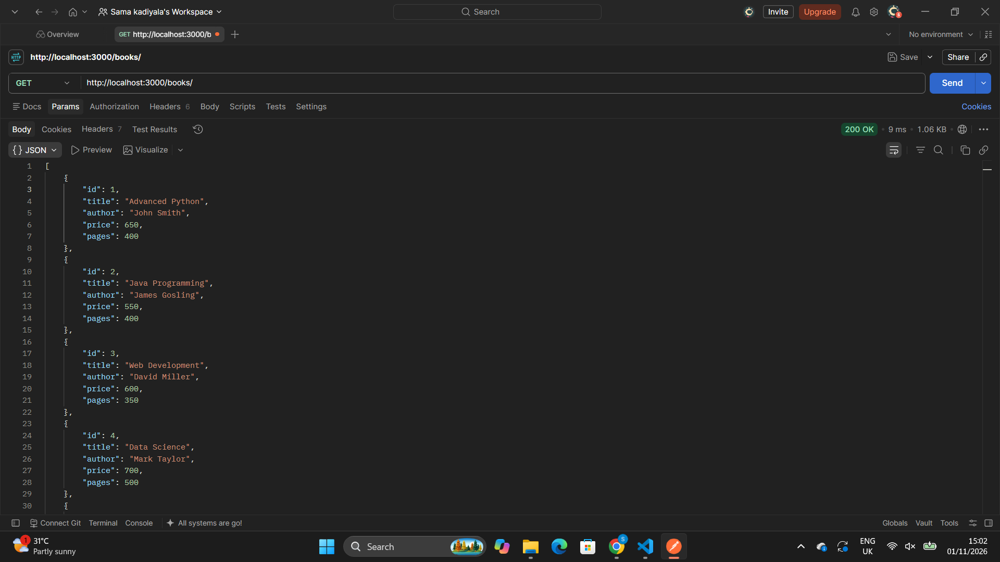

# BDF Lab 02 – SQLite Database and CRUD Operations

## Student Details

- **Name:** Kadiyala Sama Kruthika
- **Section:** S-002 AIML-2B
- **Registration Number:** 252U1R6107
## Aim

To create and integrate an SQLite database with a Node.js and Express.js application and perform CRUD operations using REST API routes.

## Technologies Used

- Node.js
- Express.js
- SQLite
- SQLite3
- JavaScript
- Postman

## Project Structure

```text
lab-02/
├── database/
│   └── books.db
├── screenshots/
├── server.js
├── package.json
├── package-lock.json
└── .gitignore
```

## Installation

Install the required dependencies:

```bash
npm install
```

## Run the Application

Start the development server:

```bash
npm run dev
```

Server URL:

```text
http://localhost:3000
```

## Database Details

**Database:** books.db

**Table:** book

| Column | Data Type |
|---|---|
| id | INTEGER PRIMARY KEY |
| title | TEXT |
| author | TEXT |
| price | INTEGER |
| pages | INTEGER |

The database contains sample book records.

## API Endpoints

| HTTP Method | Endpoint | Description |
|---|---|---|
| GET | `/books/` | Retrieve all books |
| GET | `/books/:bookId/` | Retrieve a book by ID |
| POST | `/books/` | Add a new book |
| PUT | `/books/:bookId/` | Update an existing book |
| DELETE | `/books/:bookId/` | Delete a book |

## SQL Operations

- `SELECT` – Retrieve book records.
- `INSERT` – Add new book records.
- `UPDATE` – Modify existing book records.
- `DELETE` – Remove book records.

Parameterized queries using `?` placeholders are used for queries that accept user input.

## Screenshots

### 1. GET All Books


### 2. GET Single Book


### 3. POST New Book


### 4. PUT Update Book


### 5. DELETE Book


### 6. Final Books List


## Conclusion

Successfully created an SQLite database and integrated it with a Node.js and Express.js application. Implemented and tested all five CRUD API endpoints using Postman.