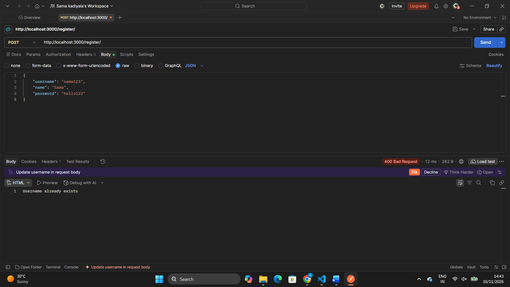
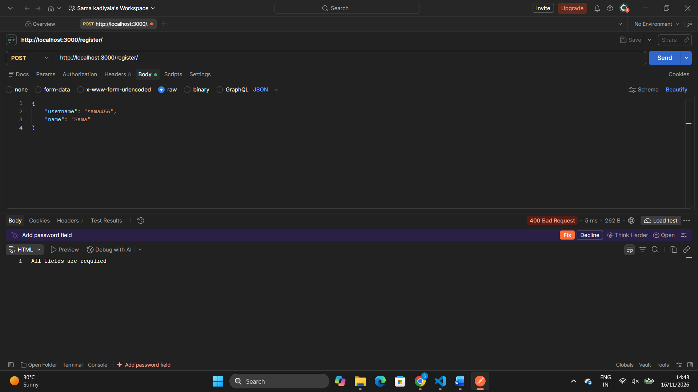
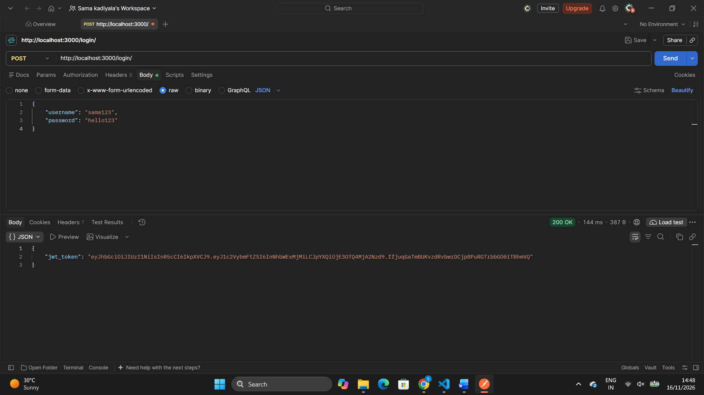
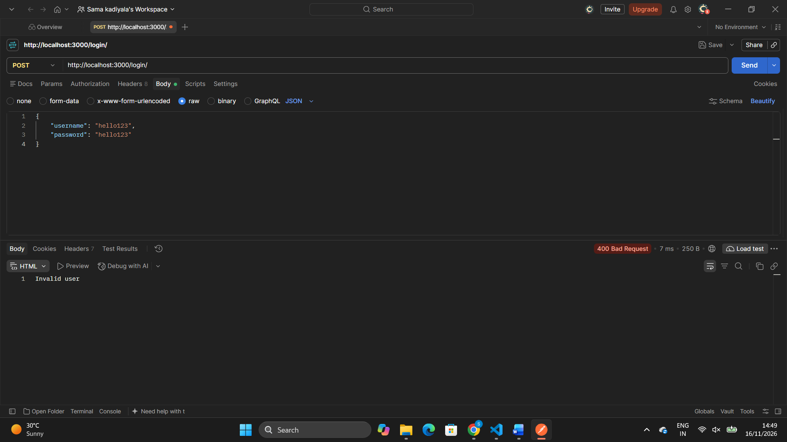
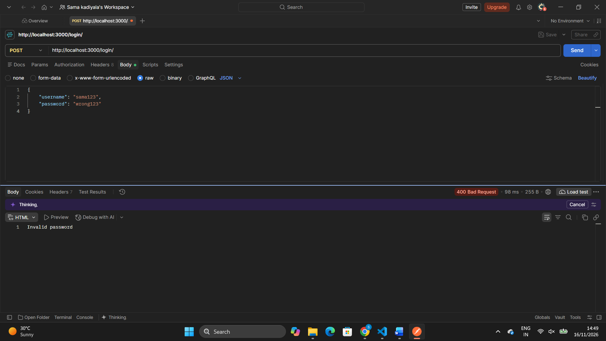
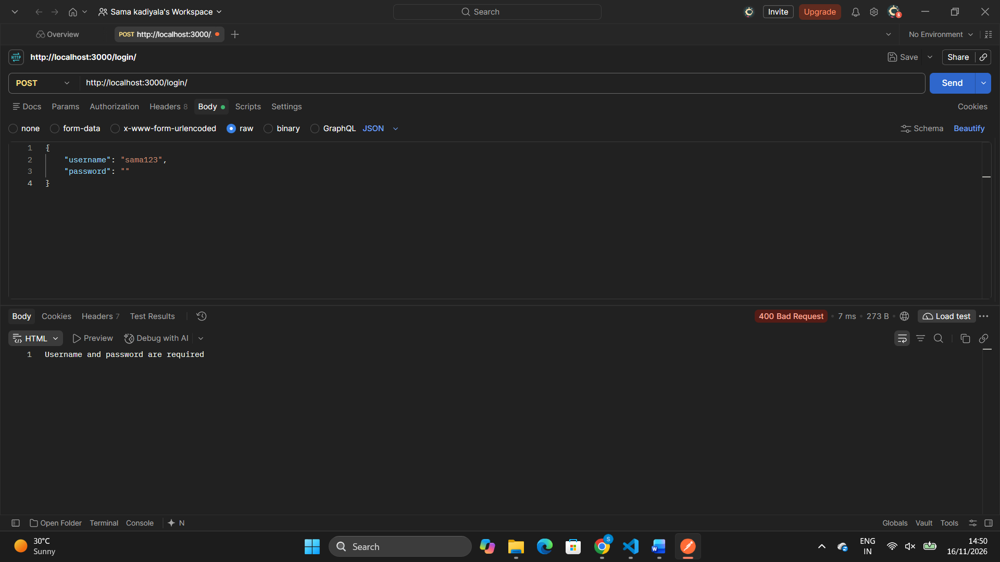
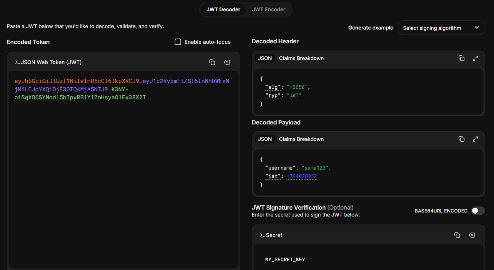
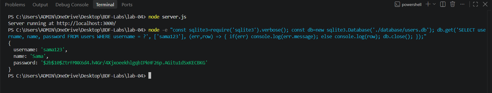

# Lab 4: Registration, Login and JWT Authentication

**Name:** Kadiyala Sama Kruthika  
**Registration Number:** 252U1R6107  
**Section:** S-002 AIML-2B  
**Subject:** Backend Development Fundamentals

## Live API Testing

### Live Registration

### Live Login

## Live Demo

https://bdf-lab-04-j5es.onrender.com

## Project Description

This project implements user registration and login using Node.js, Express.js, SQLite, bcrypt and JSON Web Tokens (JWT).

Passwords are hashed using bcrypt before being stored in the database. During login, the entered password is compared with the stored hash. If authentication is successful, a JWT token is generated containing the username.

## Technologies Used

- Node.js
- Express.js
- SQLite3
- bcrypt
- jsonwebtoken
- Postman

## Installation and Setup

1. Clone the repository.
2. Navigate to the Lab 4 folder:

   `cd lab-04`

3. Install dependencies:

   `npm install`

4. Start the server:

   `npm start`

5. Server runs at:

   `http://localhost:3000`

## Environment Variables

No environment variables are required for this lab. The JWT secret is currently defined as a constant in `server.js`, as specified in the assignment.

## API Endpoints

| Method | Endpoint | Description |
|---|---|---|
| POST | `/register/` | Register a new user |
| POST | `/login/` | Authenticate a user and generate a JWT |

## Screenshots

### 1. Successful Registration

### 2. Duplicate Username

### 3. Missing Registration Fields

### 4. Successful Login

### 5. Invalid Username

### 6. Incorrect Password

### 7. Missing Login Fields

### 8. JWT Decoding

### 9. Hashed Password in Database

## Database Structure

The SQLite database contains a `users` table with the following columns:

- `id` – Unique user ID
- `username` – Unique username
- `name` – User's name
- `password` – Bcrypt hashed password

## Security Features

- Password hashing using bcrypt.
- Password comparison using bcrypt.compare().
- JWT token generation using jwt.sign().
- Username stored in the JWT payload.
- Parameterized SQL queries to prevent SQL injection.
- Duplicate username validation.

## Conclusion

This lab demonstrates user registration, password hashing, login authentication and JWT token generation using Node.js and SQLite.
